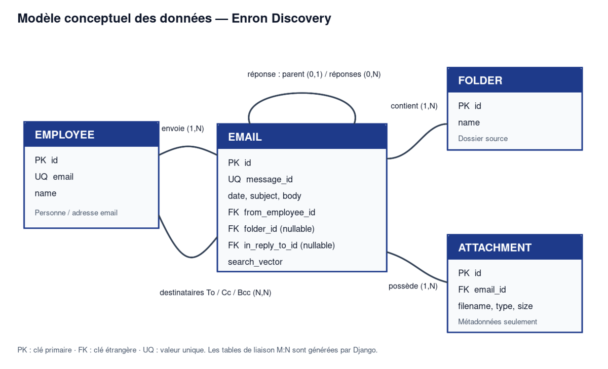

# Résumé

Enron Discovery est une application web de recherche et d’exploration d’un corpus d’emails. Elle transforme des fichiers `.eml` en données relationnelles stockées dans PostgreSQL, puis propose des pages de consultation, de recherche plein texte, d’analyse par période et d’exploration des conversations.

Le projet s’appuie sur Django pour le modèle de données, l’accès à la base et le rendu des pages. Une commande Django dédiée parcourt le corpus et importe les messages, leurs participants, leurs dossiers et les métadonnées des pièces jointes. PostgreSQL fournit la recherche plein texte et les index associés.

Le code contient neuf tests Django portant sur les principales vues. Les traces de lancement communiquées confirment que les contrôles Django passent, que les migrations sont à jour et que les pages d’accueil, du tableau de bord et d’influence ont répondu avec le statut HTTP 200. Le nombre de messages réellement importés et le résultat d’exécution des tests ne sont pas établis par ces traces.

# Contexte et objectifs

Le corpus Enron est un ensemble volumineux d’emails provenant de l’entreprise Enron. Les messages sont fournis sous forme de fichiers, souvent organisés en dossiers, et contiennent des en-têtes hétérogènes ainsi que des références aux réponses précédentes.

Le projet vise à rendre ces données consultables au moyen d’une application qui permet de :

- structurer les messages et les personnes dans une base relationnelle ;
- rechercher des termes dans le sujet et le corps des emails ;
- filtrer les résultats par expéditeur et par dates ;
- consulter les messages et reconstruire des conversations ;
- visualiser des statistiques par mois et les expéditeurs les plus actifs ;
- explorer les relations d’envoi entre expéditeurs et destinataires.

La source du corpus est le [Enron Email Dataset de Carnegie Mellon University](https://www.cs.cmu.edu/~enron/). La taille globale du corpus est décrite comme supérieure à 500 000 emails dans la documentation du projet. Ce chiffre ne représente pas nécessairement le nombre de messages importés dans la base utilisée pour la démonstration.

# Architecture technique

L’application suit une architecture web classique :

1. Le navigateur envoie une requête HTTP.
2. Django associe l’URL à une vue.
3. La vue interroge les modèles Django, qui accèdent à PostgreSQL.
4. Django rend un template HTML et renvoie la réponse au navigateur.
5. La commande d’import alimente séparément PostgreSQL à partir du corpus de fichiers.

| Composant | Rôle |
|---|---|
| Python 3.12 | Langage de l’application et de l’import |
| Django 5.2 | Modèles, vues, routes, templates, migrations et tests |
| PostgreSQL 16 | Stockage relationnel et recherche plein texte |
| Docker Compose | Démarrage local de PostgreSQL |
| `psycopg2-binary` | Connexion de Django à PostgreSQL |
| Pandas | Dépendance disponible pour les traitements exploratoires |
| Chart.js | Graphique mensuel du tableau de bord, chargé côté navigateur |

La base PostgreSQL de développement est exposée sur le port hôte `5433`. Les paramètres de connexion doivent être configurés pour l’environnement local et ne doivent pas être réutilisés tels quels en production.

# Modèle conceptuel des données

## Entités principales

| Entité | Attributs principaux | Rôle |
|---|---|---|
| **Employee** | `id`, `email` (unique), `name` | Personne identifiée par son adresse email |
| **Folder** | `id`, `name` | Dossier d’origine du message dans l’arborescence |
| **Email** | `id`, `message_id` (unique), `date`, `subject`, `body`, `search_vector` | Message importé et indexable |
| **Attachment** | `id`, `filename`, `content_type`, `size` | Métadonnées d’une pièce jointe associée à un email |



## Relations et cardinalités

| Relation | Cardinalités | Implémentation |
|---|---|---|
| Un employé envoie des emails | Un email a exactement un expéditeur ; un employé peut envoyer zéro à plusieurs emails | Clé étrangère `Email.from_employee` |
| Un email a des destinataires **To** | Un email peut avoir zéro à plusieurs destinataires ; un employé peut recevoir plusieurs emails | Relation plusieurs-à-plusieurs `to_employees` |
| Un email a des destinataires **Cc** | Même cardinalité que To | Relation plusieurs-à-plusieurs `cc_employees` |
| Un email a des destinataires **Bcc** | Même cardinalité que To | Relation plusieurs-à-plusieurs `bcc_employees` |
| Un dossier contient des emails | Un email peut ne pas avoir de dossier ou en avoir un ; un dossier peut contenir plusieurs emails | Clé étrangère nullable `Email.folder` |
| Un email répond à un autre email | Une réponse peut avoir zéro ou un parent ; un email peut avoir plusieurs réponses | Clé étrangère récursive `Email.in_reply_to` |
| Un email possède des pièces jointes | Un email peut avoir zéro à plusieurs pièces jointes ; une pièce jointe appartient à un email | Clé étrangère `Attachment.email` |

Les trois catégories de destinataires sont conservées séparément : elles n’ont pas la même signification dans les en-têtes d’un message. Les relations plusieurs-à-plusieurs sont matérialisées par les tables de liaison générées par Django.

## Modèle relationnel et intégrité

Les modèles Django imposent l’unicité des adresses des employés et des identifiants `message_id`. Les clés étrangères maintiennent les relations entre messages, expéditeurs, dossiers et pièces jointes.

La suppression d’un employé entraîne la suppression des emails dont il est l’expéditeur. La suppression d’un dossier ou d’un parent de conversation conserve les emails concernés en mettant la relation correspondante à `NULL`. La suppression d’un email entraîne celle de ses pièces jointes. Les destinataires To, Cc et Bcc sont stockés dans trois relations distinctes.

Cette séparation réduit la répétition des informations relatives aux personnes et aux messages. Elle constitue une structure relationnelle normalisée adaptée aux fonctionnalités du projet. Les contraintes métier supplémentaires, telles que la déduplication d’une pièce jointe par empreinte de contenu, ne sont pas implémentées.

# Indexation et recherche

Le modèle `Email` contient des index sur la date, l’identifiant du message et le champ PostgreSQL `search_vector`. L’index GIN sur `search_vector` est destiné à accélérer les recherches plein texte.

À l’import, le champ de recherche est alimenté à partir du sujet et du corps avec `SearchVector("subject", "body")`. La vue de recherche applique `SearchQuery` et classe les résultats avec `SearchRank`. Elle accepte également un filtre sur l’adresse de l’expéditeur et des bornes de dates.

La configuration linguistique de la recherche n’est pas explicitement fixée dans l’appel à `SearchVector` ou `SearchQuery` ; elle dépend donc de la configuration PostgreSQL/Django par défaut. Une pondération différente du sujet et du corps n’est pas implémentée. Aucun benchmark de durée ou de charge n’a été réalisé : les index sont des choix d’optimisation de conception, pas une preuve de performance mesurée.

# Pipeline d’importation

La commande `polls/management/commands/import_enron.py` reçoit le chemin racine du corpus avec l’option obligatoire `--path`. Elle parcourt récursivement les fichiers et utilise la bibliothèque Python `email` pour analyser les messages.

## Étapes de traitement

1. Vérification du chemin et décompte des fichiers présents.
2. Chargement en mémoire des `message_id` déjà présents pour éviter les réinsertions.
3. Création ou récupération du dossier correspondant au répertoire courant.
4. Lecture du fichier `.eml` et extraction des en-têtes expéditeur, destinataires, date, sujet, identifiant et réponse.
5. Création ou récupération des employés ; un expéditeur de remplacement est utilisé si l’en-tête expéditeur est absent.
6. Extraction du corps texte, avec suppression de certains blocs de réponse et disclaimers ciblés.
7. Validation des dates : les dates non analysables ou hors de la plage 1990–2010 sont enregistrées comme nulles.
8. Création de l’email, association des destinataires To/Cc/Bcc et tentative de liaison avec le parent de conversation.
9. Enregistrement des métadonnées des pièces jointes et alimentation du champ de recherche plein texte.
10. Affichage d’un bilan comprenant notamment les messages importés, déjà présents, ignorés, en erreur, les dates invalides et les champs FTS non indexés.

L’import est incrémental par `message_id`, mais les enregistrements sont créés individuellement : le code ne met pas en œuvre `bulk_create` par lots. Les pièces jointes sont représentées par leurs métadonnées ; le contenu binaire n’est pas stocké dans le modèle.

## Limites du pipeline

- Si un message parent n’a pas encore été importé lorsque sa réponse est traitée, le lien `in_reply_to` n’est pas établi automatiquement plus tard.
- Pour les messages multiparties, le code conserve le premier segment `text/plain` décodé en UTF-8 ; les autres variantes ou encodages peuvent être incomplets.
- Les erreurs sont comptabilisées et l’import continue, ce qui facilite le traitement d’un corpus hétérogène mais nécessite d’examiner le bilan final.
- La commande valide les dates selon une plage choisie pour le corpus ; cette règle doit être réévaluée si d’autres sources sont importées.

# Fonctionnalités de l’application

| Page | Fonctionnement |
|---|---|
| Accueil (`/`) | Affiche les volumes d’emails et d’employés ainsi que les cinq principaux expéditeurs |
| Tableau de bord (`/dashboard/`) | Agrège les emails par mois dans la plage 1990–2010, affiche les dix principaux expéditeurs et un graphique mensuel |
| Recherche (`/search/`) | Recherche plein texte, filtres expéditeur et dates, classement par pertinence et pagination de 20 résultats |
| Détail d’un thread (`/thread/<id>/`) | Remonte au message racine puis collecte récursivement les réponses et les affiche chronologiquement |
| Graphe d’influence (`/influence/`) | Présente sous forme de tableau les 100 paires expéditeur–destinataire To les plus fréquentes ; filtre facultatif par adresse |
| Liste des emails (`/emails/`) | Affiche les emails par date, avec pagination de 50 éléments |
| Administration (`/admin/`) | Interface Django d’administration |

Le « graphe d’influence » actuel est une liste tabulaire, et non une visualisation de réseau. Son calcul s’appuie sur les destinataires To ; les relations Cc et Bcc n’y sont pas incluses. La recherche d’expéditeur utilise une correspondance partielle d’adresse.

# Installation et utilisation

Depuis le dossier parent qui contient le sous-dossier `enron_discovery`, les commandes de démarrage local sont :

```bash
cd enron_discovery
python3 -m venv .venv
source .venv/bin/activate
python -m pip install --upgrade pip
python -m pip install -r requirements.txt
docker compose up -d
python manage.py migrate
```

Après avoir téléchargé et extrait le corpus dans un répertoire `maildir`, lancer l’import :

```bash
python manage.py import_enron --path ./maildir
```

Pour compter les lignes importées et lancer l’application :

```bash
python manage.py shell -c "from polls.models import Email, Employee, Attachment; print('Emails:', Email.objects.count(), 'Employés:', Employee.objects.count(), 'Pièces jointes:', Attachment.objects.count())"
python manage.py runserver
```

L’application est ensuite accessible sur `http://127.0.0.1:8000/`. Les pages principales sont `/dashboard/`, `/search/`, `/influence/`, `/emails/` et `/admin/`.

`makemigrations` n’est pas requis à chaque installation : il faut le lancer lorsqu’un changement de modèle doit produire une nouvelle migration. Pour une base neuve avec les migrations déjà fournies, `migrate` suffit.

# Vérifications et tests

## Éléments confirmés

Les traces de lancement fournies pour le projet indiquent :

- le contrôle système Django s’est terminé sans problème ;
- `makemigrations` n’a détecté aucun changement ;
- `migrate` n’a trouvé aucune migration en attente ;
- le serveur de développement a démarré ;
- les requêtes vers `/`, `/influence/` et `/dashboard/` ont répondu avec le statut HTTP 200.

Ces vérifications confirment le démarrage de l’application et le rendu de ces pages dans l’environnement de démonstration. Elles ne démontrent pas à elles seules que le corpus complet a été importé ni que toutes les fonctionnalités retournent des résultats avec des données réelles.

## Tests automatisés

Le fichier `polls/tests.py` contient neuf tests couvrant l’accueil, le tableau de bord, la recherche par mot-clé, expéditeur et dates, la pagination, les threads, l’influence et la liste des emails.

Commande à exécuter depuis `enron_discovery` avec PostgreSQL démarré :

```bash
source .venv/bin/activate
docker compose up -d
python manage.py test polls -v 2
```

La suite n’a pas pu être exécutée dans l’environnement de rédaction de ce rapport : PostgreSQL n’était pas joignable sur `127.0.0.1:5433`. Aucun résultat « réussi » n’est donc revendiqué ici. Avant le rendu, il est recommandé de lancer cette commande dans l’environnement du projet et d’ajouter le résultat réel.

## Résultats de l’import

Le nombre d’emails, d’employés et de pièces jointes effectivement présents dans la base n’est pas disponible dans les traces examinées. Il doit être relevé après import à l’aide de la commande de comptage de la section 7. Le bilan affiché par la commande d’import doit également être conservé pour documenter le nombre de fichiers traités et les erreurs rencontrées.

# Limites et améliorations envisagées

1. **Compléter la validation** : exécuter les neuf tests avec PostgreSQL, puis consigner le résultat et les versions utilisées.
2. **Documenter l’import réel** : indiquer le chemin/version du corpus, les compteurs d’import et les éventuelles erreurs, sans confondre la taille théorique du corpus avec les lignes chargées.
3. **Fiabiliser les threads** : ajouter une étape de résolution après import pour relier les réponses dont le parent a été importé plus tard.
4. **Améliorer l’ingestion** : prendre en charge les encodages variés, les alternatives multiparties et les cas d’en-têtes invalides avec des tests dédiés.
5. **Évaluer les performances** : mesurer l’import et les requêtes sur un volume documenté avant d’annoncer un gain de performance.
6. **Préciser la recherche** : choisir explicitement la configuration linguistique PostgreSQL et tester la pertinence sur des termes du corpus.
7. **Enrichir l’analyse d’influence** : inclure éventuellement Cc/Bcc et remplacer la table actuelle par un vrai graphe interactif.
8. **Préparer une mise en production** : externaliser les secrets, désactiver le mode debug, mettre en place une authentification adaptée et utiliser un serveur WSGI/ASGI de production plutôt que `runserver`.
9. **Vérifier la suppression d’index redondants** : l’identifiant `message_id` est unique et possède aussi un index déclaré dans le modèle ; l’utilité de cet index additionnel devrait être confirmée.

# Conclusion

Enron Discovery met en œuvre une chaîne complète de structuration et de consultation : parsing de fichiers email, modélisation relationnelle, stockage PostgreSQL, recherche plein texte et interface Django. La séparation des entités et des types de destinataires permet de représenter les informations essentielles du corpus ; les pages web couvrent les principaux cas d’utilisation prévus.

Les validations observées confirment que le projet démarre et que plusieurs pages répondent correctement. Pour présenter des résultats expérimentaux complets, il reste à exécuter les tests automatisés avec PostgreSQL accessible et à relever les compteurs de l’import réel. Les performances n’ayant pas été mesurées, elles ne sont pas quantifiées dans ce rapport.

# Références

- Carnegie Mellon University, [Enron Email Dataset](https://www.cs.cmu.edu/~enron/).
- Django, [Documentation de la version 5.2](https://docs.djangoproject.com/en/5.2/).
- PostgreSQL, [Full Text Search](https://www.postgresql.org/docs/16/textsearch.html).
- Python, [Package `email`](https://docs.python.org/3/library/email.html).
- Code du projet : modèles `polls/models.py`, vues `polls/views.py`, commande `polls/management/commands/import_enron.py` et tests `polls/tests.py`.
